<div align="center">

# 📟 PINET

### Dual-Screen Raspberry Pi 3B Cyber-Deck

**An all-in-one battery-powered appliance: offline hotspot & captive message board, 2.13" e-ink rear telemetry panel, 7" touchscreen photo frame & kiosks, Wi-Fi auditing station, and wireless media centre.**

<br />

[](LICENSE)
[](https://www.raspberrypi.com/)
[-a80030.svg?style=flat-square)](https://www.debian.org/)
[](https://www.python.org/)
[](tests/)
[](#hardware-architecture)
[-informational.svg?style=flat-square)](#subsystems)
[-f59e0b.svg?style=flat-square)](#power-management-and-battery-guard)

<br />

[Overview](#overview) • [Feature Highlights](#feature-highlights) • [Hardware Architecture](#hardware-architecture) • [Subsystems](#subsystems) • [Screenshots](#screenshots) • [Getting Started](#getting-started) • [Usage & CLI](#usage-and-operation)

<br />

| [▶️ **Watch Demo on YouTube**](https://youtu.be/Q5zrIVO-YQM) | [📖 **Read Build Guide on Hackster.io**](https://www.hackster.io/rupal2k/pinet-dual-screen-pi-cyber-deck-7a8dd3) |
|:---:|:---:|

<br />

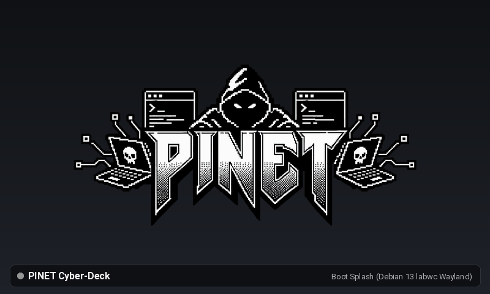

</div>

<br />

---

## Overview

PINET started as an e-ink status display and grew into five coexisting subsystems
sharing a single Raspberry Pi 3B. They run under a tight 5 V power budget: an
on-board power manager sheds background services whenever heavy touchscreen kiosks
run, and no service starts at boot unless it must.

This repository contains the complete source code, system configurations, desktop
definitions, unit tests and documentation for the device. For the full architectural
design write-up, see [`docs/Device Overview.md`](docs/Device%20Overview.md).

### Core Design Principles

- **100% Offline-First**: PINET operates independently of upstream internet connections. The message board, captive portal, and internal utilities require no external server.
- **Power Budget Discipline**: A proactive load-shedding daemon manages the single 5 V rail, preventing under-voltage brownouts (`0x50005`) and USB bus resets during heavy tasks.
- **Dual-Display Synergy**: The primary 7" touchscreen handles rich GUI apps and kiosks, while the rear 2.13" e-Paper panel provides always-on system telemetry with zero static current draw.
- **Strict Network Isolation**: The open guest Wi-Fi hotspot (`wlan0`) is air-gapped by nftables rules, completely dropping guest access to host SSH and VNC ports.

---

## Feature Highlights

| Subsystem | Key Technologies | Operational Role |
|---|---|---|
| **Dual Displays** | 7" DSI Touchscreen (800×480) + 2.13" e-Paper (250×122) | Front GUI for desktop, kiosks & video; always-on rear panel for system telemetry & join QR. |
| **Storage & Security** | LUKS2 (`aes-xts-plain64` 512-bit), Argon2id, GTK Layer-Shell | Boot PIN unlock pad (`pinet-luks-unlock`) with systemd `Type=notify`; seamless crossfade directly to photo frame. |
| **Offline Hotspot** | Broadcom `wlan0` (`10.10.10.1`), hostapd, dnsmasq | Air-gapped Wi-Fi network triggering captive portal into `pinet-board` (message board + 1 GB file drop). |
| **Media Centre** | Raspotify, VLC, UVC Video (`ffmpeg`/`ffplay`), PipeWire | Spotify Connect (Bluetooth @ 150% boost), live 576p Indian IPTV streams, and low-latency HDMI field monitor. |
| **Wi-Fi Auditing** | `nmap`, `aircrack-ng`, `wifite`, `reaver`, `mdk4`, Vte terminal | Touch grid with embedded terminal pane; pentest mode flips `wlan1` to monitor mode & alerts e-ink. |
| **Ethernet Share** | `eth0` (`10.42.0.1/24`), dnsmasq DHCP, nftables NAT | Routes `wlan1` internet uplink out through Ethernet with optional Pi-hole ad-blocking DNS. |
| **Power & Battery** | Waveshare UPS HAT (D), INA219 (I²C `0x43`), 8400 mAh | Real-time voltage/current monitoring, calibrated OCV math, auto-shutdown guard, and load shedding. |

---

## Hardware Architecture

### Schematic & Interconnect Topology

<div align="center">
  <a href="docs/images/block-diagram.png" target="_blank" title="Click to view full-resolution schematic">
    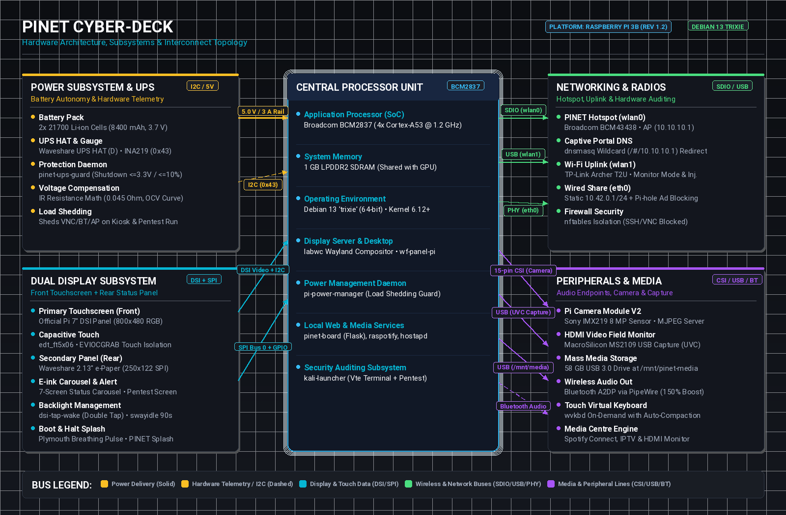
  </a>
  <p align="center">
    <a href="docs/images/block-diagram.png" target="_blank">🔍 <b>Open Full-Resolution Diagram (1600 × 1050 px)</b></a> &nbsp;•&nbsp;
    <a href="#interactive-flowchart">📊 <b>Jump to Hardware Flowchart</b></a>
  </p>
</div>

<div id="interactive-flowchart"></div>

<details>
<summary><b>View Hardware Architecture Flowchart (Mermaid)</b></summary>
<br />

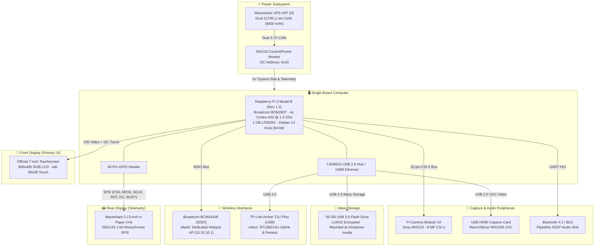

</details>

---

## Software Architecture & IPC Topology

### Subsystem Interconnect & Power Coordination

<div align="center">
  <a href="docs/images/architecture.png" target="_blank" title="Click to view full-resolution software architecture">
    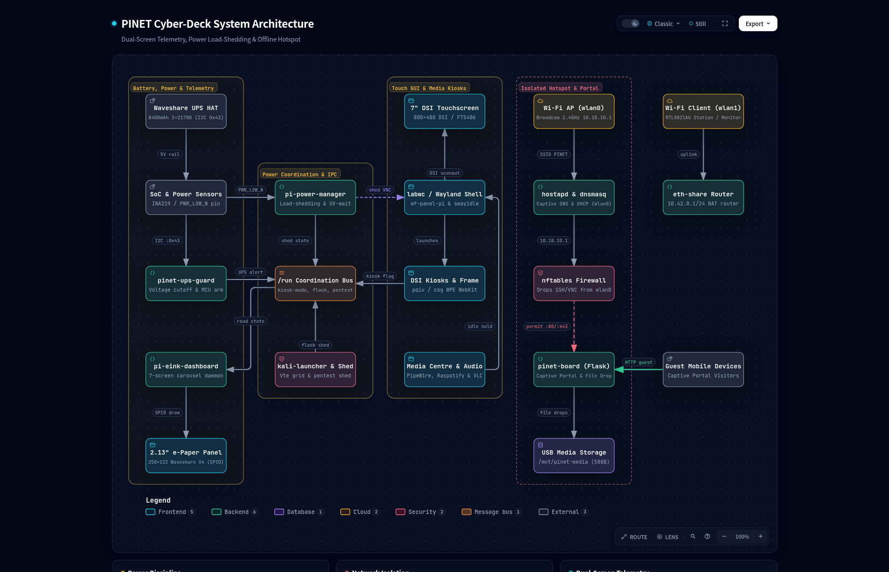
  </a>
  <p align="center">
    <a href="docs/images/architecture.png" target="_blank">🔍 <b>Open Full-Resolution Architecture (2048 × 1320 px)</b></a> &nbsp;•&nbsp;
    <a href="docs/architecture.html" target="_blank">🌐 <b>Open Interactive Archify Diagram</b></a> &nbsp;•&nbsp;
    <a href="#software-flowchart">📊 <b>Jump to Software Flowchart</b></a>
  </p>
</div>

<div id="software-flowchart"></div>

<details>
<summary><b>View Software Subsystems & IPC Flowchart (Mermaid)</b></summary>
<br />

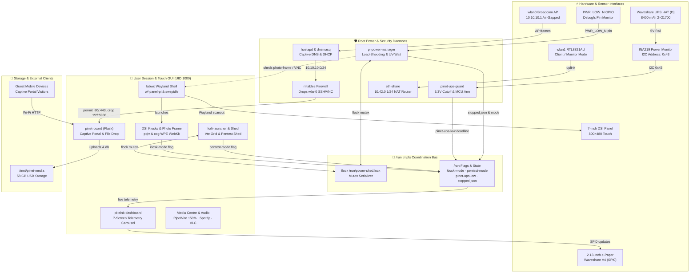

</details>

---

## Power Coordination & Brownout Mitigation Lifecycle

<div align="center">
  <a href="docs/images/power-lifecycle.png" target="_blank" title="Click to view full-resolution power management lifecycle">
    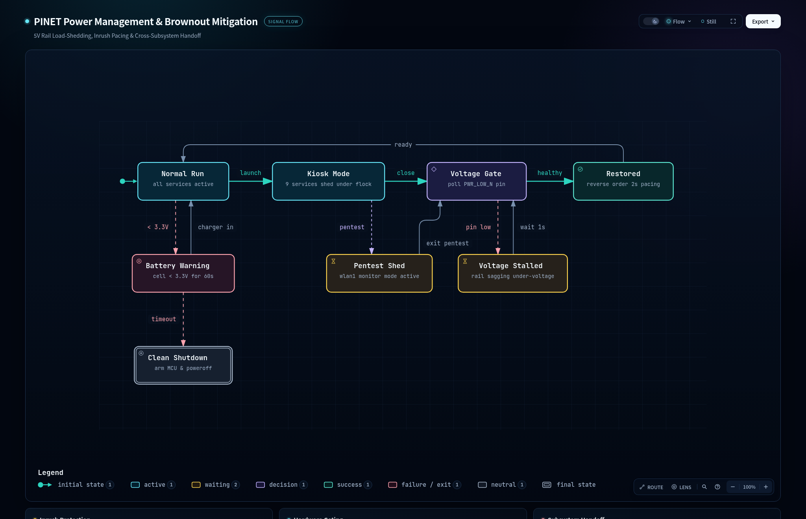
  </a>
  <p align="center">
    <a href="docs/images/power-lifecycle.png" target="_blank">🔍 <b>Open Full-Resolution Lifecycle (2048 × 1320 px)</b></a> &nbsp;•&nbsp;
    <a href="docs/power-lifecycle.html" target="_blank">⚡ <b>Open Interactive Archify Lifecycle</b></a> &nbsp;•&nbsp;
    <a href="#power-state-machine">📊 <b>Jump to State Machine</b></a>
  </p>
</div>

<div id="power-state-machine"></div>

<details>
<summary><b>View Power Management State Machine (Mermaid)</b></summary>
<br />

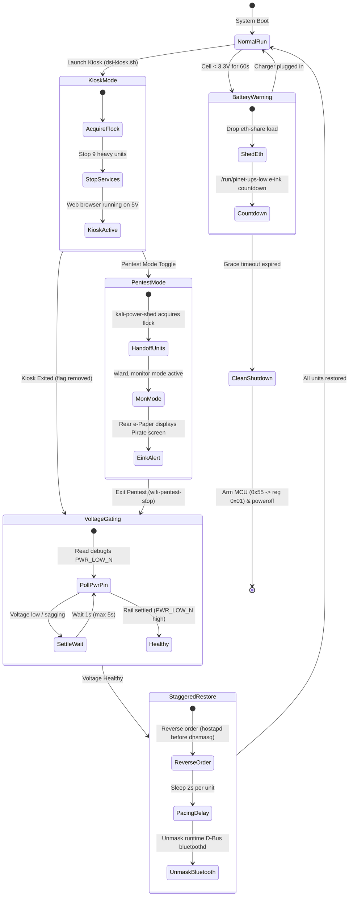

</details>

### Component Bill of Materials

| Component | Part / Specification | Interface | Role |
|---|---|---|---|
| **Single-Board Computer** | Raspberry Pi 3 Model B Rev 1.2 | — | Broadcom BCM2837, 4× Cortex-A53 @ 1.2 GHz, 1 GB LPDDR2 |
| **Operating System** | Debian 13 "trixie" (64-bit) | SD Card | Kernel 6.12+, systemd, labwc Wayland compositor |
| **Touchscreen** | Official Raspberry Pi 7" Touchscreen | DSI + I²C | 800×480 capacitive touch (`edt_ft5x06`), primary UI |
| **Status Display** | Waveshare 2.13" e-Paper HAT (V4) | SPI (bus 0) | 250×122 1-bit monochrome rear status panel |
| **Power Management** | Waveshare UPS HAT (D) | I²C (`0x43`) | Dual 21700 cells (8400 mAh), INA219 voltage/current sensor |
| **Hotspot Radio** | On-board Broadcom BCM43438 | SDIO (`wlan0`) | Dedicated 2.4 GHz 802.11n AP for `PINET` (`10.10.10.1`) |
| **Uplink / Auditing Radio** | TP-Link Archer T2U Plus (RTL8821AU) | USB (`wlan1`) | 2.4/5 GHz home uplink; monitor mode and packet injection |
| **Mass Storage** | 58 GB USB 3.0 flash drive | USB | Encrypted LUKS2 (AES-256 + Argon2id), mounted at `/mnt/pinet-media` |
| **Camera** | Raspberry Pi Camera Module V2 (IMX219) | 15-pin CSI | 8 MP sensor for live viewer and still/video capture |
| **Video Capture** | USB UVC HDMI Capture Dongle (MS2109) | USB | Full-screen HDMI field monitor input |
| **Audio Output** | Bluetooth A2DP Sink (Speaker/Headphones) | Bluetooth | PipeWire / WirePlumber audio endpoint |

---

## Subsystems

### E-ink Status Dashboard

<details open>
<summary><b>Click to expand architecture & operational details</b></summary>
<br />

An always-on 2.13" panel on the rear of the deck provides continuous system
telemetry without waking the touchscreen. Driven over SPI by
`pi-eink-dashboard.service`. Because e-paper holds an image with zero current,
the panel draws power only while refreshing.

- **Rotating Carousel**: Cycles through seven information cards:
  1. *Clock and Date*: 12-hour local time and calendar date.
  2. *System Health*: CPU utilization percentage, RAM consumption, and SoC temperature.
  3. *Live Weather*: Current conditions and forecast via web API.
  4. *Network Status*: IP addresses for `eth0`, `wlan0` (hotspot), and `wlan1` (station).
  5. *Wi-Fi Join QR*: Scannable QR code encoding the local home Wi-Fi credentials.
  6. *PINET Hotspot Card*: SSID, guest board password, and connected client count.
  7. *Hardware Voltage*: INA219 bus voltage and disk space indicators.
- **Auditing Alert**: Switches to a pirate "PENTEST" banner when Wi-Fi auditing starts.
- **Clean Shutdown Splash**: Displays a persistent PINET logo during system halt or reboot.

</details>

### PINET Hotspot and Message Board

<details>
<summary><b>Click to expand architecture & operational details</b></summary>
<br />

A self-contained, internet-free wireless network hosted on the internal Broadcom
radio (`wlan0`, `10.10.10.1`). When client devices connect, a dnsmasq wildcard DNS
responder (`address=/#/10.10.10.1`) triggers the mobile captive portal prompt,
opening the `pinet-board` web application.

- **Anonymous Message Board**: SQLite-backed bulletin board for local discussions.
- **File Sharing (up to 1 GB)**: Upload and download files directly from mobile
  browsers. Large files stream directly to `/mnt/pinet-media/` with dedicated `TMPDIR`
  handling to protect the Pi's 463 MB RAM-backed `/tmp` from exhaustion.
- **In-Browser Preview**: Inline viewing for images, PDFs, text, and videos (`/view/<id>`),
  with forced download and `X-Content-Type-Options: nosniff` headers on executable or
  scriptable file types (`.html`, `.svg`, `.js`).
- **Two-Tier Authentication**: Single password prompt differentiates between Guest
  (view, post, upload, download; password shown on e-ink) and Admin (file deletion;
  managed via `set_password.py`).
- **Network Isolation**: Strict nftables rules prevent hotspot clients from accessing
  SSH (port 22) or VNC (port 5900). Started and stopped on demand.

</details>

### Touchscreen Photo Frame and Kiosks

<details>
<summary><b>Click to expand architecture & operational details</b></summary>
<br />

An official Raspberry Pi 7" capacitive touchscreen (800×480) driven by `labwc`
(Wayland) and `wf-panel-pi` under a custom PINET dark theme.

- **Full-Disk LUKS2 Storage Decryption**: Early in the boot cycle, `pinet-luks-unlock` acts as the primary gatekeeper before any user media mounts. Runs as a systemd user service (`Type=notify`, `TimeoutStartSec=0`) rendered via GTK layer-shell overlay. Upon entering the 4-digit PIN, it decrypts `/dev/sda` to `/mnt/pinet-media` and fires `systemd-notify --ready`, smoothly handing off to the photo frame without exposing the desktop.
- **Photo Frame Slideshow**: Runs fullscreen via `pqiv` when the device is idle or immediately after boot unlock.
  Images from `/mnt/pinet-media/slideshow/` are normalized to 800×480 and displayed
  fit-to-screen over blurred letterboxing rather than cropped.
- **Photo Frame Close & Desktop Transition**: The photo frame features a touch close button (`dsi-close-button.py`) rendered via GTK layer-shell above the fullscreen slideshow. The button is initially invisible (`DSI_CLOSE_AUTOHIDE=4`); a corner tap reveals it for four seconds. To close, a deliberate second tap (at least 0.8 s after reveal) runs `dsi-photo-close`. A `DSI_CLOSE_DELAY=10` startup guard keeps the button inert for the first 10 seconds, preventing an accidental close during the boot animation. `dsi-photo-close` raises `dsi-lock.py` fullscreen *before* stopping the slideshow — the desktop is never briefly visible. Entering the PIN calls `Gtk.main_quit()` on the lock overlay only; the frame is not restarted. `dsi-photo-frame.service` uses `Restart=on-failure` with `SuccessExitStatus=143` so an explicit stop (SIGTERM) never triggers an unwanted restart loop.
- **Touch Sleep and Double-Tap Wake**: After 90 seconds of inactivity, `swayidle`
  blanks the DSI output and backlight. While asleep, `dsi-tap-wake.py` grabs the
  touchscreen evdev node exclusively (`EVIOCGRAB`) so stray contact cannot trigger
  desktop icons. A rapid double-tap re-lights the display and re-arms the sleep timer.
- **Passcode Lock Screen**: Taskbar lock icon launches `dsi-lock.py`, presenting an
  on-screen numeric keypad before restoring desktop access.
- **On-Screen Keyboard**: Integrated `wvkbd` launcher in the taskbar. Auto-compresses
  window geometry when active so input fields remain visible.
- **Lightweight Kiosks**: On-demand shortcuts launch the Pi Camera (`dsi-cam-server.py`
  providing 640×480 MJPEG at 10 fps with upright photo/video capture), the Ezykam
  smart-camera viewer, and the PINET Portal. Kiosks run in `cog` (WPE WebKit) or
  PyQt6 to prevent the high memory overhead of full desktop browsers.

</details>

### Media Centre

<details>
<summary><b>Click to expand architecture & operational details</b></summary>
<br />

A unified touch interface (`media-centre`) providing three dedicated entertainment
modes behind one desktop launcher:

- **Spotify Connect**: Runs `raspotify` as a background receiver. Sound routes to
  connected Bluetooth speakers via PipeWire. If no speaker is currently connected,
  it attempts reconnection with paired devices (prioritizing the last-used speaker).
  Forces speaker volume to 150% so the source phone's volume slider controls the
  full audible range.
- **IPTV Player**: Plays live Indian broadcast streams in English, Bengali, and
  Hindi from `iptv-org`. Automatically filters playlists to 576p streams (avoiding
  Pi 3B hardware decoding bottlenecks) and pre-probes stream endpoints when the list
  opens. VLC plays full-screen while a media flag suppresses screen blanking.
  Corner touch controls (Back, Play/Pause, Close) auto-hide after 4 seconds.
- **HDMI Field Monitor**: Connects to a USB UVC HDMI capture card (tested with
  MacroSilicon MS2109) to convert the touchscreen into an external HDMI field monitor
  for laptops or cameras. Streams video through low-latency `ffmpeg` and `ffplay`
  pipelines with automatic recovery if the USB bus resets.

</details>

### Wi-Fi Auditing Toolkit

<details>
<summary><b>Click to expand architecture & operational details</b></summary>
<br />

A specialized launcher (`kali-launcher`) for wireless and network assessments on
authorized hardware:

- **Touch-Friendly Tool Grid**: Quick-access cards for `nmap`, `aircrack-ng`, `wifite`,
  `reaver`, `bully`, `mdk4`, `hcxdumptool`, `hcxtools`, `macchanger`, and `tcpdump`.
- **Embedded Terminal**: An integrated GTK3/Vte terminal pane hosts interactive
  ncurses sessions (e.g. `wifite`, `airodump-ng`) directly within the window. Cards
  automatically collapse when the on-screen keyboard opens.
- **Pentest Power Mode**: `wifi-pentest-start` switches the external USB Wi-Fi
  dongle (`wlan1`) into monitor mode, stops the PINET hotspot, sheds non-essential
  power consumers, and updates the e-ink screen with the pirate skull indicator.
  `wifi-pentest-stop` cleanly restores station mode.

</details>

### Ethernet Share

<details>
<summary><b>Click to expand architecture & operational details</b></summary>
<br />

Routes uplink connectivity from the Wi-Fi interface (`wlan1`) out through the
built-in Ethernet jack (`eth0`):

- **DHCP and Routing**: Assigns static `10.42.0.1/24` to `eth0`, hands out DHCP leases
  from `10.42.0.10` to `10.42.0.254` via dnsmasq, and configures nftables NAT masquerade.
- **Ad-Blocking**: Includes an optional local Pi-hole DNS interception toggle.
- **Touch and CLI Controls**: Managed either via command line (`eth-share`) or an
  on-screen touchscreen window (`eth-share-gui`).

</details>

### Power Management and Battery Guard

<details>
<summary><b>Click to expand architecture & operational details</b></summary>
<br />

Because the Raspberry Pi 3B shares a single 5 V rail across its SoC, dual displays,
CSI camera, and USB peripherals, unmanaged power draws can trigger under-voltage
throttling (`0x50005`) or USB bus resets. PINET implements multi-layered power controls:

- **Battery Telemetry (`pinet-battery`)**: Interrogates the INA219 sensor on the
  Waveshare UPS HAT (D) over I²C (`0x43`). Calculates resting voltage by compensating
  for internal pack resistance ($IR = 0.045\,\Omega$), interpolates battery percentage
  against an empirically measured Open Circuit Voltage curve (3.35 V to 4.20 V), and
  renders a battery status icon in the taskbar.
- **Automatic Shutdown Guard (`pinet-ups-guard`)**: Monitors battery levels every 15
  seconds. When the pack drops to critical levels ($\le 3.3\,\text{V}$ under load or
  $\le 10\%$), the daemon executes an orderly shutdown to protect the SD card from
  sudden power loss.
- **Proactive Load Shedding (`pi-power-manager`)**: Whenever high-demand workloads
  (kiosks or pentest mode) launch, this daemon automatically stops background consumers
  (VNC, Bluetooth, PINET hotspot, photo frame slideshow). When the workload exits,
  services are restored in staggered 2-second intervals, verifying voltage stability
  at each step.
- **I/O Flush Protection (`dsi-install-guard`)**: Blanking the DSI display and tuning
  kernel dirty memory thresholds (`/etc/sysctl.d/90-sd-writeback.conf`) during `apt`
  operations avoids SD controller stalls.

</details>

---

## Screenshots

The cyberdeck features two dedicated physical displays: a **Front 7" DSI Capacitive Touchscreen (800×480)** for interactive Wayland apps and video, and a **Rear 2.13" e-Paper Display (250×122)** for zero-power system telemetry.

---

### Display 1: Front 7" DSI Touchscreen (800×480)

Driven by `labwc` (Wayland compositor) with `wf-panel-pi` under a custom dark theme. Touch interactions are optimized for fingertip navigation with 90-second display sleep and double-tap wake.

#### Desktop Shell & System Utilities

| | |
|---|---|
| <a href="docs/images/desktop.png" target="_blank"></a><br>**Wayland Touch Desktop.** Single-tap application launchers with battery telemetry, taskbar lock, and virtual keyboard toggle. | <a href="docs/images/lock-screen.png" target="_blank">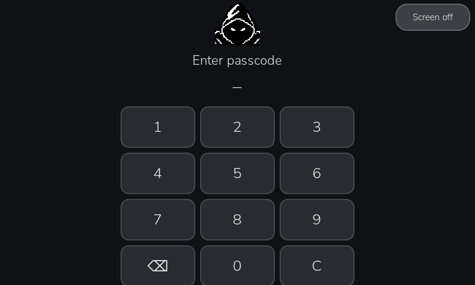</a><br>**Passcode Lock Screen.** Fullscreen numeric keypad overlay (`dsi-lock.py`) securing the touch session against unauthorized input. |
| <a href="docs/images/brightness-slider.png" target="_blank">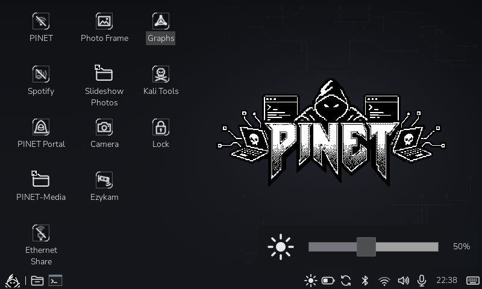</a><br>**Backlight Brightness Slider.** Taskbar brightness adjustment widget with an enforced 10% hardware minimum floor. | <a href="docs/images/pinet-confirm.png" target="_blank">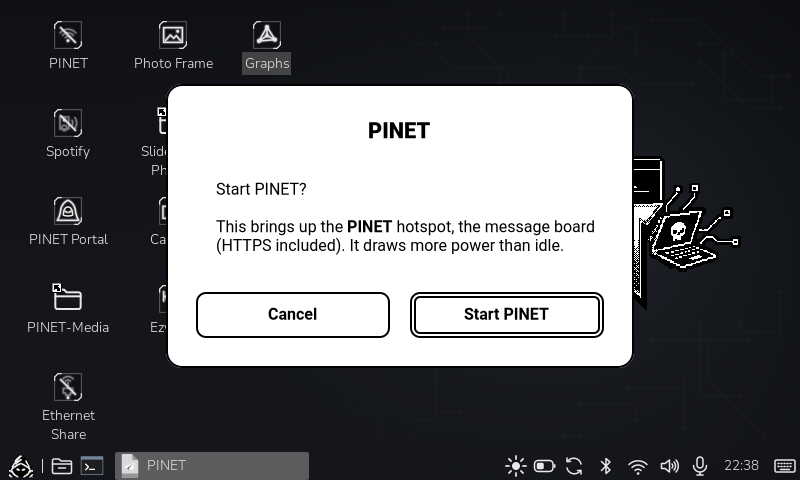</a><br>**Service Confirmation Modal.** Pre-flight safety prompt prior to starting or stopping system daemons. |
| <a href="docs/images/boot-splash.png" target="_blank">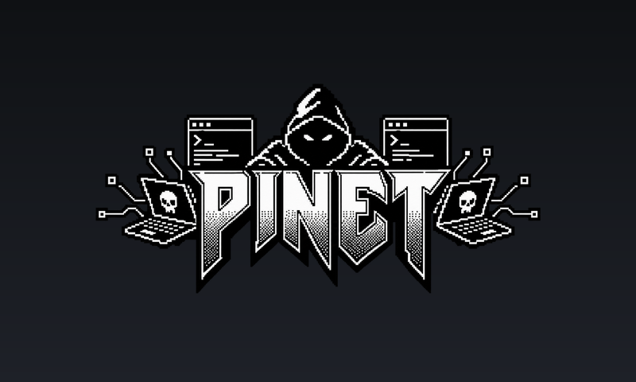</a><br>**Plymouth Boot & Shutdown Splash.** Dark boot splash theme featuring breathing logo glow and progress bar. | <a href="docs/images/graph-viewer.png" target="_blank">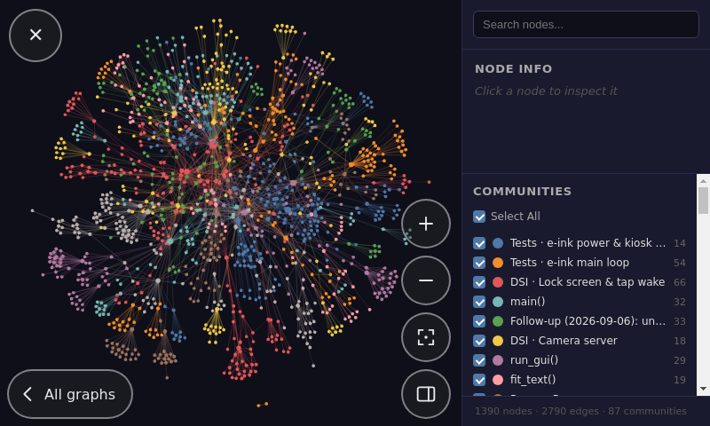</a><br>**Code Graph Viewer.** Touch-friendly on-device visualizer for inspecting repository structure and module dependencies. |

#### Media Centre & External Video Capture

| | |
|---|---|
| <a href="docs/images/media-centre.png" target="_blank">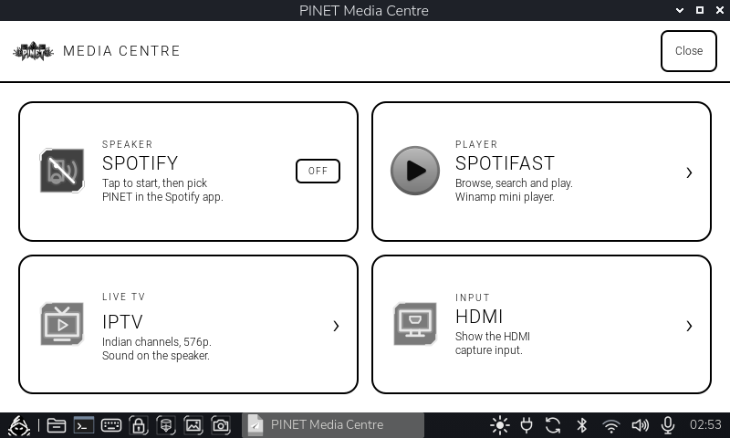</a><br>**Media Centre Home.** Unified mode launcher for Spotify Connect, IPTV, and HDMI input with live status indicator. | <a href="docs/images/spotify-confirm.png" target="_blank">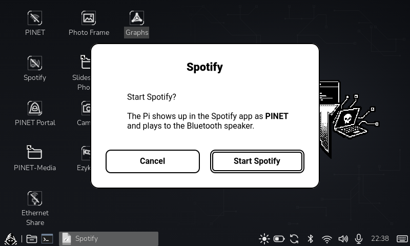</a><br>**Spotify Connect Launcher.** Confirmation prompt before spawning raspotify receiver and auto-reconnecting Bluetooth speaker. |
| <a href="docs/images/media-centre-iptv.png" target="_blank">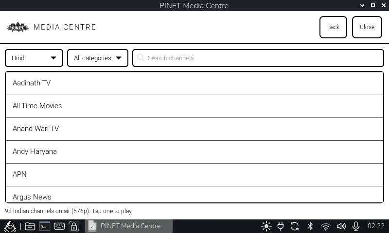</a><br>**IPTV Channel Guide.** Filtered Indian broadcasts in English, Bengali, and Hindi, pre-probed for live HLS streams. | <a href="docs/images/media-centre-video.png" target="_blank"></a><br>**Full-Screen Playback.** Stream playback with auto-hiding corner touch controls (Back, Play/Pause, Close). |
| <a href="docs/images/hdmi-monitor.png" target="_blank"></a><br>**HDMI Field Monitor.** Full-screen low-latency preview feed from an external laptop or camera via USB UVC capture dongle. | **HDMI Capture Pipeline**<br>Receives 1080p/720p 60Hz HDMI video via MacroSilicon MS2109 dongle, rendered with sub-120ms latency through an optimized `ffplay` pipeline with automatic USB bus recovery. |

#### Hotspot, Captive Portal & Network Auditing

| | |
|---|---|
| <a href="docs/images/portal-login.png" target="_blank">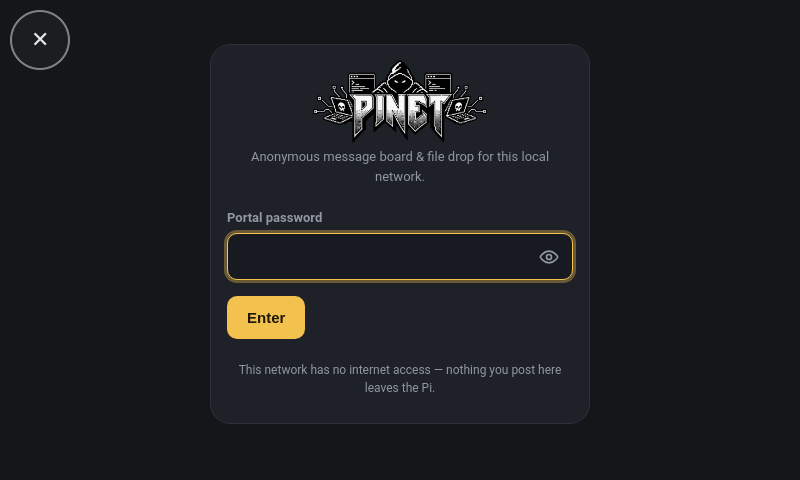</a><br>**Captive Portal & Bulletin Board.** Offline mobile web interface (`pinet-board`) with guest and admin authentication tiers. | <a href="docs/images/kali-tools.png" target="_blank">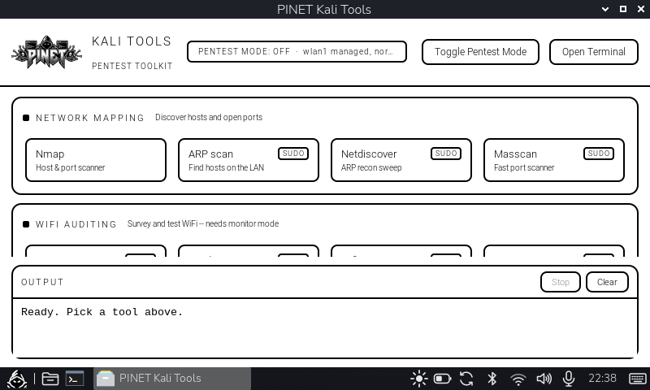</a><br>**Wi-Fi Auditing Launcher.** Grid of wireless security tools with an integrated GTK3/Vte interactive terminal pane. |
| <a href="docs/images/ethernet-share.png" target="_blank">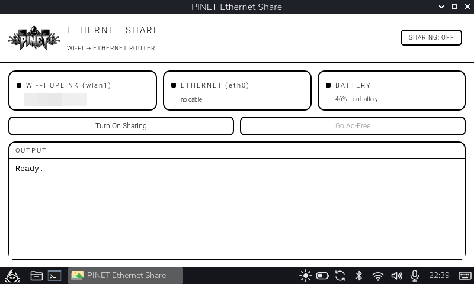</a><br>**Ethernet Share GUI.** Touchscreen control panel for routing Wi-Fi uplink through `eth0` with optional Pi-hole DNS interception. | **Network Isolation & Security**<br>Guest Wi-Fi on `wlan0` (`10.10.10.1`) is isolated by nftables rules, completely dropping guest access to host SSH (`22`) and VNC (`5900`) ports. |

---

### Display 2: Rear 2.13" Waveshare e-Paper HAT (250×122)

Positioned on the rear of the cyberdeck enclosure and driven over SPI bus 0 by `pi-eink-dashboard.service`. Because e-paper holds an image with zero current, telemetry remains visible even while the unit is asleep or halting.

| | |
|---|---|
| <a href="docs/images/eink-status.png" target="_blank">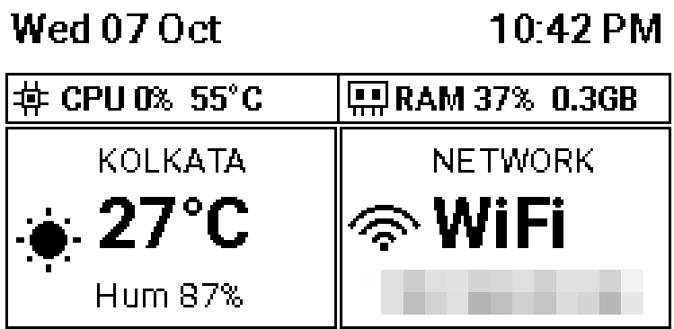</a><br>**System Telemetry & Health.** Rotating carousel card displaying 12-hour clock, CPU load, RAM usage, SoC temperature, battery voltage, and IP addresses. | <a href="docs/images/eink-hotspot.png" target="_blank">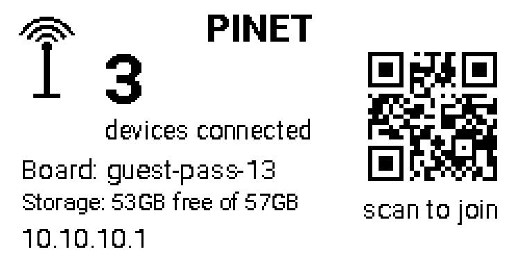</a><br>**Hotspot Join Card.** Displays current SSID (`PINET`), guest bulletin board passcode, and active connected client count. |

---

## Getting Started

### Prerequisites

- A Raspberry Pi 3B with Debian 13 "trixie" (or Raspberry Pi OS 64-bit).
- Hardware assembled per the [Hackster.io build guide](https://www.hackster.io/rupal2k/pinet-dual-screen-pi-cyber-deck-7a8dd3).
- Passwordless `sudo` configured for the primary user.
- I²C and SPI enabled in `/boot/firmware/config.txt`.

### Step 1: E-ink Dashboard Installation

The e-ink status dashboard includes an automated setup script that enables the
hardware interfaces, fetches the Waveshare driver, installs Python dependencies,
and sets up systemd services:

```bash
git clone https://github.com/rupal2k/pinet.git
cd pinet/eink-dashboard
chmod +x scripts/install.sh
./scripts/install.sh
```

Verify service status:

```bash
sudo systemctl status pi-eink-dashboard.service
journalctl -u pi-eink-dashboard.service -f
```

### Step 2: Deploying System Files

Install the remaining system scripts, services, and configurations to their
expected filesystem locations:

```bash
# Core user-facing scripts and background daemons
sudo install -m 755 scripts/bin/* /usr/local/bin/
sudo install -m 755 scripts/sbin/* /usr/local/sbin/

# Systemd services and drop-ins
sudo cp -r systemd/* /etc/systemd/system/
sudo systemctl daemon-reload

# Network and hardware configuration files
sudo cp -r etc/* /etc/

# Captive portal web application
sudo mkdir -p /opt/pinet-board
sudo cp -r pinet-board/* /opt/pinet-board/
sudo chown -R pinet-board:pinet-board /opt/pinet-board

# Desktop shortcuts and icons
mkdir -p ~/.config ~/.local/share/icons ~/Desktop
cp -r config/* ~/.config/
cp -r desktop/icons/* ~/.local/share/icons/
cp desktop/*.desktop ~/Desktop/
chmod +x ~/Desktop/*.desktop
```

### Step 3: Media Storage Setup

Attach an external USB flash drive formatted as ext4, create the required
directory structure, and configure `/etc/fstab`:

```bash
sudo mkdir -p /mnt/pinet-media/{uploads,camera,slideshow}
sudo chown -R rupal:rupal /mnt/pinet-media/slideshow /mnt/pinet-media/camera
sudo chown -R pinet-board:pinet-board /mnt/pinet-media/uploads
```

### Step 3b: USB Storage Encryption (Optional)

Encrypt the USB flash drive with LUKS2 so all photos, uploads, and backup data
are encrypted at rest. A PIN screen appears before the photo frame on each boot.

**Prerequisites**: complete Steps 1–3 and set the DSI passcode (Step 4) first,
since the same PIN is used for both the lock screen and the disk unlock screen.

```bash
# Install cryptsetup if not present
sudo apt install cryptsetup

# Set your DSI lock PIN (Step 4) BEFORE running this
echo -n "YOUR_PIN" | sudo tee /etc/dsi-lock/passcode > /dev/null
sudo chmod 600 /etc/dsi-lock/passcode

# Run the interactive encryption setup (erases and re-encrypts the USB drive)
sudo pinet-media-encrypt
```

The setup script: backs up all USB data to the SD card, formats the drive as
LUKS2 (AES-256 + Argon2id KDF), restores the data, updates `/etc/fstab` and
`/etc/crypttab`, installs the `pinet-luks-unlock` boot PIN service (`Type=notify`),
and adds a systemd drop-in so `dsi-photo-frame` starts immediately upon unlock without
ever exposing the desktop.

> **Seamless Boot Sequence:**
> 1. E-ink dashboard initializes first (`pi-eink-dashboard.service`).
> 2. Touchscreen backlight wakes with fullscreen PIN dialog (`pinet-luks-unlock`).
> 3. PIN entered → LUKS decrypted & mounted → triggers `systemd-notify --ready`.
> 4. Photo slideshow launches fullscreen (`dsi-photo-frame.service`).
> 5. Tapping close (`X`) on slideshow brings up the screen lock (`dsi-lock.py`).
> 6. Screen PIN entered → active Wayland desktop revealed.

> **Recovery (SSH):** if the PIN dialog fails to appear:
> ```bash
> sudo cryptsetup open /dev/sda pinet-media && sudo mount /mnt/pinet-media
> ```

See [`docs/storage-encryption.md`](docs/storage-encryption.md) for full details
and the restore procedure.

---

### Step 4: Passwords and Credentials

Set authentication keys and passwords. No default credentials exist in the
repository:

```bash
# Set PINET portal admin and guest passwords
sudo python3 /opt/pinet-board/set_password.py
sudo python3 /opt/pinet-board/set_guest_password.py

# Set DSI touchscreen passcode (numeric PIN)
echo -n "1234" | sudo tee /etc/dsi-lock/passcode > /dev/null
sudo chmod 600 /etc/dsi-lock/passcode
```

### Step 5: Plymouth Boot Splash

Install the custom animated boot theme:

```bash
sudo install -D -m 644 -t /usr/share/plymouth/themes/pinet plymouth/pinet/*
sudo plymouth-set-default-theme -R pinet
```

---

## Usage and Operation

### Touchscreen Desktop

| Action | Interaction | Behavior |
|---|---|---|
| **Launch Service** | Single tap on icon | Opens confirmation prompt prior to starting or stopping daemon. |
| **Media Centre** | Tap **Media Centre** icon | Select Spotify, IPTV, or HDMI Monitor. Spotify card indicates live status. |
| **Watch IPTV** | Tap **IPTV** | Opens channel selector. Tapping video corner displays playback controls. |
| **HDMI Capture** | Tap **HDMI Monitor** | Connect HDMI cable, then tap to open low-latency fullscreen preview. |
| **Lock Screen** | Tap lock icon in taskbar | Engages `dsi-lock.py` overlay. Requires PIN to dismiss. |
| **Virtual Keyboard** | Tap keyboard icon in taskbar | Spawns `wvkbd`. Dismiss by tapping the floating edge tab. |
| **Screen Brightness** | Tap or scroll brightness icon | Adjusts backlight between 10% floor and 100%. Auto-saves to config. |
| **Display Sleep / Wake** | Idle 90s / Double-tap screen | Automatically sleeps. Double-tap wakes display and re-arms sleep timer. |

### Command-Line Utilities

PINET provides standalone CLI commands for manual control and automation:

| Command | Arguments | Purpose |
|---|---|---|
| `pinet-battery` | `--once` | Prints live voltage, current (mA), resting percentage, and power state. |
| `pinet-battery` | `--log <file>` | Appends CSV telemetry per minute to calibrate battery discharge curves. |
| `pinet-brightness` | `--once` | Outputs current and saved DSI backlight brightness levels. |
| `pinet-start` | — | Starts `pinet-ap-network`, `hostapd`, `dnsmasq`, and `pinet-board`. |
| `pinet-stop` | — | Stops hotspot services and tears down the AP network. |
| `wifi-pentest-start` | — | Puts `wlan1` into monitor mode, sheds power consumers, alerts e-ink. |
| `wifi-pentest-stop` | — | Restores `wlan1` to managed Wi-Fi station mode and normal power profile. |
| `eth-share` | `[on\|off\|status]` | Enables or disables Ethernet routing and optional Pi-hole filtering. |
| `pi-diagnostic` | `[all\|eink\|network\|dsi]` | Runs automated functional tests against live hardware interfaces. |
| `hdmi-monitor` | `[--device]` | Finds connected UVC capture device or launches full-screen viewer. |

### Service Management and Diagnostic Logs

Monitor system behavior with standard journald commands:

```bash
# Monitor Media Centre and VLC stream playback
journalctl --user -t media-centre -f

# Monitor HDMI video capture pipeline and USB recovery events
journalctl -t hdmi-monitor -f

# Inspect Spotify Connect receiver daemon
journalctl -u raspotify.service -f

# Check hardware under-voltage status (0x0 means healthy, 0x50005 indicates throttling)
vcgencmd get_throttled
```

---

## Security and Secrets

- **No Secrets in Source**: Passwords, TLS keys, Flask secret tokens, and lock-screen
  PINs are never committed to git. They reside solely on the physical device in
  mode-restricted files (`/etc/pinet-board/`, `/etc/dsi-lock/passcode`).
- **Open Hotspot with Isolated Access**: The PINET Wi-Fi hotspot is intentionally
  open for easy guest access. However, web application operations require authentication,
  and the host firewall strictly drops inbound SSH (port 22) and VNC (port 5900)
  packets arriving over `wlan0`.
- **Upload Hardening**: User uploads are stripped of path traversals, prepended
  with random tokens, and stored outside web roots. Scriptable MIME types are forced
  to download with `nosniff` headers to block stored XSS attacks.
- **Legal Compliance**: Wi-Fi auditing utilities (`kali-launcher`) are intended solely
  for authorized security assessments on networks you own or have explicit written
  permission to test.

To report security issues, refer to [SECURITY.md](SECURITY.md).

---

## Known Limitations

- **5 V Power Sensitivity**: Heavy concurrent operations (compiling packages, large
  file transfers, or software video decoding) can cause input rail voltage sags.
  Under-voltage can trigger temporary USB bus resets. A stable 5 V / 3 A supply
  and heavy-gauge wiring are recommended.
- **Single Radio Contention**: The external adapter (`wlan1`) handles both normal
  internet connectivity and monitor-mode frame injection. Entering pentest mode
  temporarily disconnects the Pi from its uplink network.
- **Software Video Decoding**: The Raspberry Pi 3B lacks hardware acceleration for
  USB MJPEG decoding. 720p at 30 fps requires approximately 1.2 CPU cores.
- **Bluetooth Dropouts**: The on-board Broadcom Bluetooth controller can drop audio
  frames under sustained Wi-Fi throughput. Using an external USB Bluetooth dongle
  resolves radio interference.

---

## Repository Layout

```
.
├── config/              # User configuration (~/.config): labwc, GTK themes, taskbar
├── desktop/             # Desktop shortcuts, menu entries, and custom PINET SVG icons
├── docs/                # Architecture guides, hardware notes, and screenshot assets
├── eink-dashboard/      # E-ink status dashboard (SPI driver, carousel src, systemd units)
├── etc/                 # System configuration: hostapd, dnsmasq, nftables, NetworkManager
├── pinet-board/         # Captive portal Flask application (message board and file drop)
├── plymouth/            # PINET custom boot splash theme
├── scripts/
│   ├── bin/             # /usr/local/bin: Touchscreen apps, media centre, kali launcher
│   └── sbin/            # /usr/local/sbin: Power manager, ups guard, pentest scripts
├── systemd/             # Systemd service units, timers, and drop-in configurations
├── tests/               # Standalone unit test suite (301 tests, Python standard library)
└── tools/               # Developer utilities: icon generators, code-graph refreshers
```

---

## Testing

The repository includes a comprehensive unit test suite written strictly with the
Python standard library. Tests run on any Linux or macOS environment without
requiring Raspberry Pi hardware or display servers:

```bash
python3 -B -m unittest discover -s tests
```

- **Filesystem Consistency**: Verifies that every installed path referenced by desktop
  files, systemd units, or shell scripts matches an existing file in the repository.
- **Headless Execution**: GUI modules lazily import GTK and Vte, allowing argument
  parsing, playlist caching, and configuration parsers to be tested in CI environments.
- **Power and Battery Math**: Validates battery percentage interpolation, resting
  voltage formulas, and load-shedding sequencing.

---

## Contributing

Contributions and bug reports are welcome. Please read [CONTRIBUTING.md](CONTRIBUTING.md)
and adhere to the [Code of Conduct](CODE_OF_CONDUCT.md). Ensure all unit tests pass
prior to submitting pull requests.

---

## License

This project is licensed under the MIT License. See [LICENSE](LICENSE) for details.

---

## Acknowledgements

- [iptv-org/iptv](https://github.com/iptv-org/iptv) for public channel playlists.
- [raspotify](https://github.com/dtcooper/raspotify) and [librespot](https://github.com/librespot-org/librespot) for Spotify Connect audio streaming.
- [VLC media player](https://www.videolan.org/) for stream decoding.
- [Waveshare](https://www.waveshare.com/) for e-Paper hardware and driver libraries.
